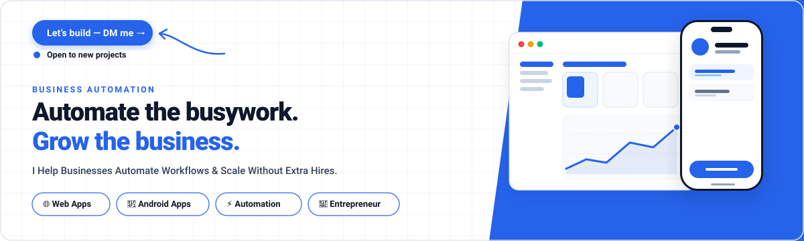
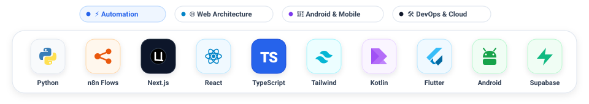

  <!-- Apple Minimal Hero Banner -->
  

    

  <!-- Clean Headline -->
  <h3>I Help Businesses Automate Workflows &amp; Scale Without Extra Hires</h3>
  
<b>Web &amp; Android Developer &nbsp;•&nbsp; Automation Specialist &nbsp;•&nbsp; Entrepreneur</b>

  <!-- Action Badges -->
  

    
    
    
    
  

---

### ⚡ What I Do

- **Workflow Automation**: Build zero-touch 24/7 API pipelines that eliminate repetitive manual busywork.
- **Web Engineering**: High-speed SaaS platforms, interactive client portals, and real-time dashboards.
- **Android Apps**: Native & cross-platform mobile apps with fluid UX and offline-first reliability.

---

### 🛠️ Tech Stack

  

---

  
<b>Have a project or workflow to automate?</b>

  
    
  Workflows that run 24/7 — at zero extra cost. © Hassnain Leghari

<!-- ============================================================== -->
<!-- SEO & Semantic Search Optimization Metadata                     -->
<!-- Keywords: Hassnain Leghari, HassnainLeghari, Business Automation, -->
<!-- Workflow Automation Specialist, Web Developer, Android Developer, -->
<!-- Entrepreneur, Python Automation, Zapier Integration, n8n, Make,   -->
<!-- Next.js Developer, React, Node.js, Kotlin Developer, Flutter,     -->
<!-- SaaS Founder, Business Automation Consultant, Freelance Engineer  -->
<!-- ============================================================== -->
